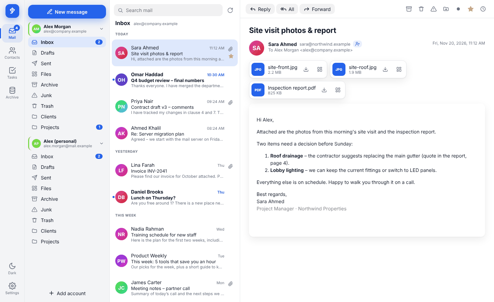
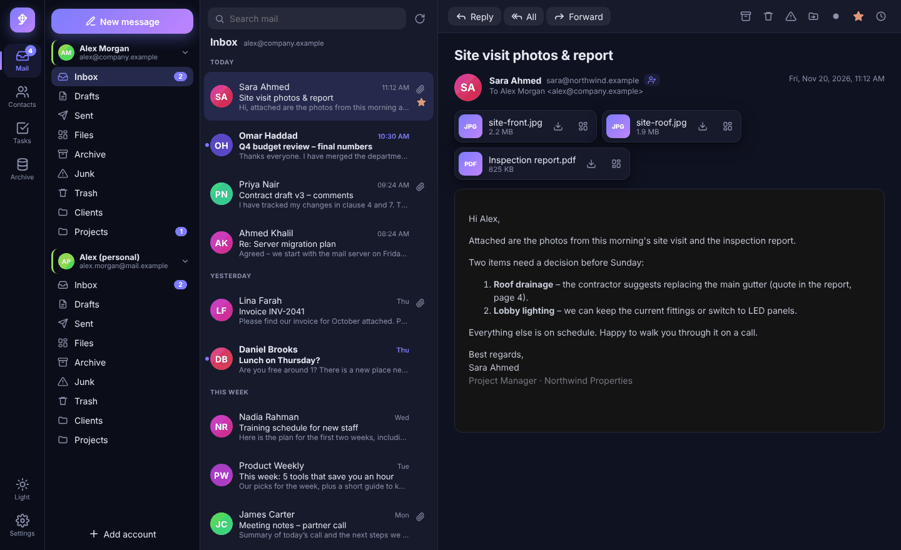
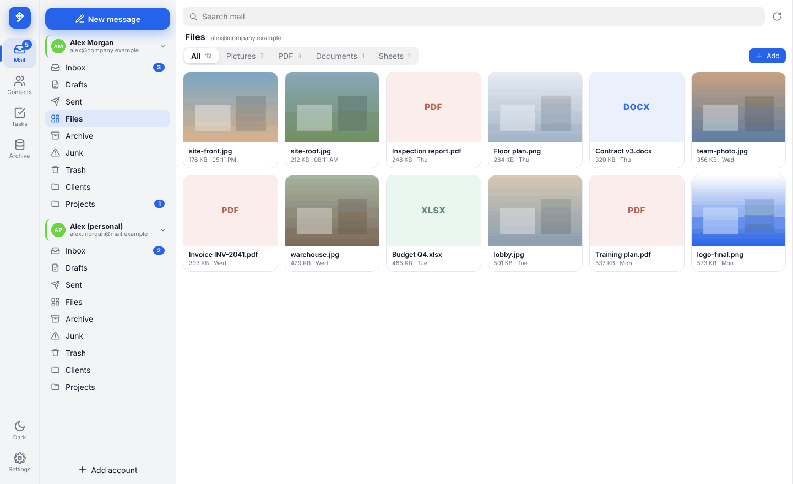
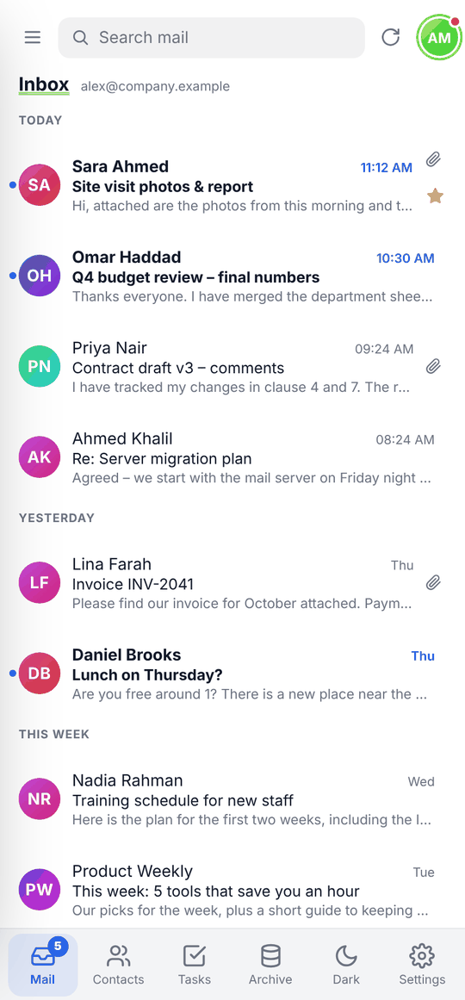
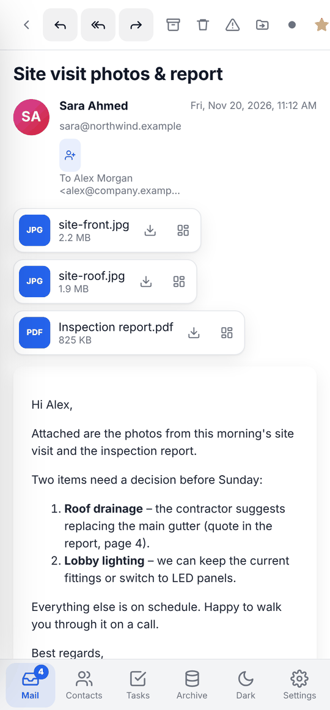
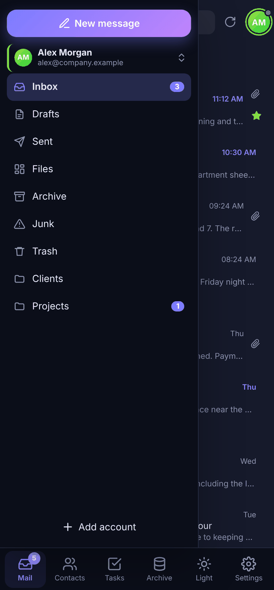
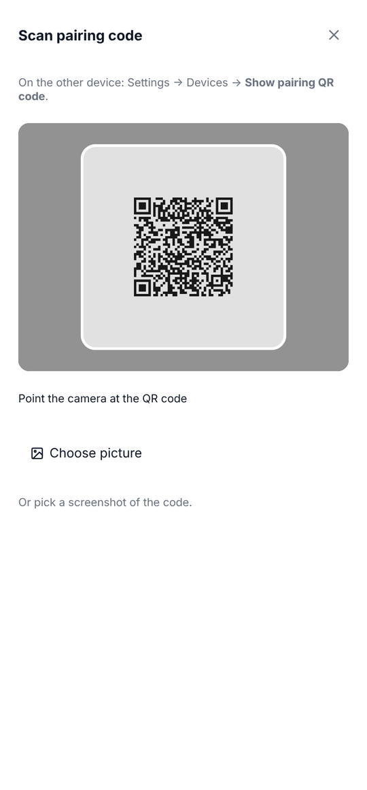
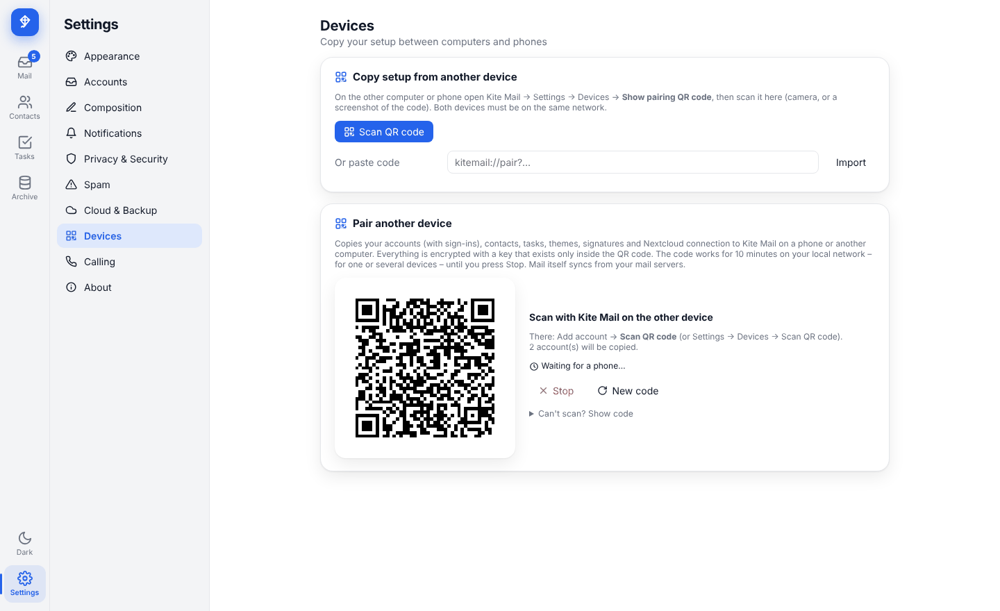

# Kite Mail

A fast, lightweight email app for **Windows, Linux and Android**.
Works with **Microsoft 365, Gmail** and any **IMAP** mail server (cPanel, Hostinger, Zoho…).

## Download

Get the newest version from the **[Releases page](https://github.com/AkhilMathew-5322/Kite-mail/releases/latest)**:

| Device | File to download |
|---|---|
| **Windows 10/11** | `Kite.Mail_…_x64-setup.exe` |
| **Android** | `KiteMail-v…-android-arm64.apk` |
| **Linux** | `….deb` (Ubuntu/Debian) or `….AppImage` (any distro) |

- **Windows:** if a blue "Windows protected your PC" box appears, click **More info → Run anyway**. The app isn't code-signed yet.
- **Android:** open the APK and allow **Install unknown apps** when asked. Updates install over the old version and keep your accounts.

## Get started

1. Open Kite Mail and click **Add account**.
2. Pick **Microsoft 365**, **Gmail** or **Other (IMAP)** and sign in.
   - Other (IMAP): enter your email, password and the IMAP/SMTP servers from your mail provider.
   - Microsoft 365 and Gmail need a one-time setup by an admin: see the [setup guide](docs/SETUP.md).
3. **Already using Kite Mail on another computer or phone?** Choose **Add account → Scan QR code**. Then, on the other device, go to **Settings → Devices → Show pairing QR code**. All your accounts, contacts and settings are copied in one scan, with no passwords to type.

## What it can do

- **Instant new mail** with notifications (push, no waiting).
- **Conversations**: replies are grouped together, including your own answers.
- **Files folder**: pictures, PDFs and documents from your mail are collected in one folder. It syncs to every device and shows in Outlook and other apps too.
- **Archive**: open old **PST, MSG, EML, MBOX** and Maildir files, then search and forward from them.
- **Contacts and tasks** with reminders, synced with Nextcloud if you use it.
- **Backups** to S3 or Nextcloud, and large attachments sent as download links.
- **Safe by default**: remote images blocked, scam-link warnings, dangerous attachments can't be opened.
- **Themes**: light, dark and solid colours (Black, Blue, Emerald…).
- **Phone app** with swipe to archive / mark read, back gestures and a QR scanner.

## Screenshots

| Dark theme | Files folder |
|---|---|
|  |  |

**Android**

  
  
  
  

**Copy your setup to another device**

Screenshots use made-up demo data.

## Privacy

- Your mail stays between Kite Mail and **your own mail server**. There is no Kite Mail cloud and no tracking.
- Passwords and sign-ins are kept in the system's secure storage (Windows Credential Manager, the Linux keyring, and on Android the app's private storage that other apps can't read).
- Emails can't run scripts, and tracking images are blocked until you allow them.

## More

- [Setup guide](docs/SETUP.md): Microsoft 365, Gmail, other providers, Nextcloud, S3, 3CX calling, grammar checking
- [What's new](docs/CHANGELOG.md): every version's changes
- [For developers](docs/DEVELOPERS.md): building from source, releases, Android signing, tests, code layout
